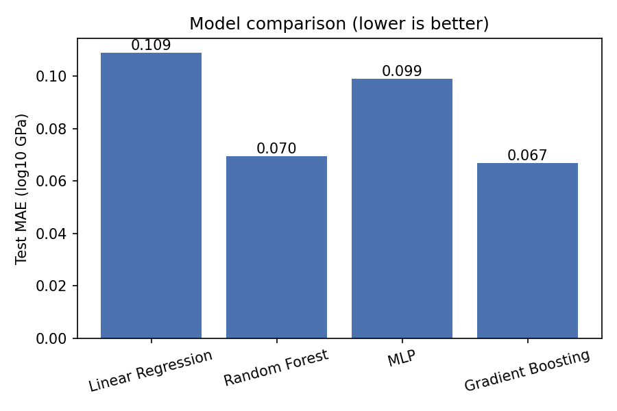
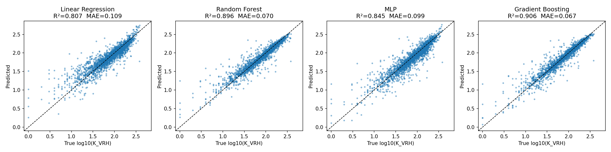
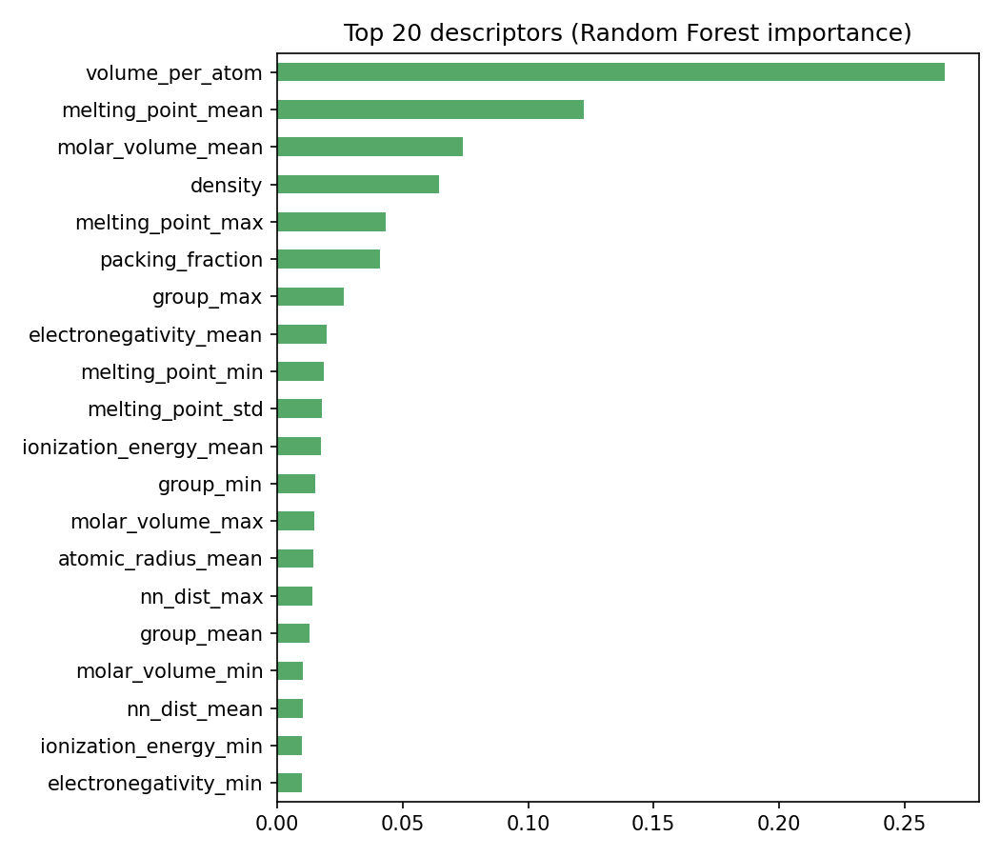
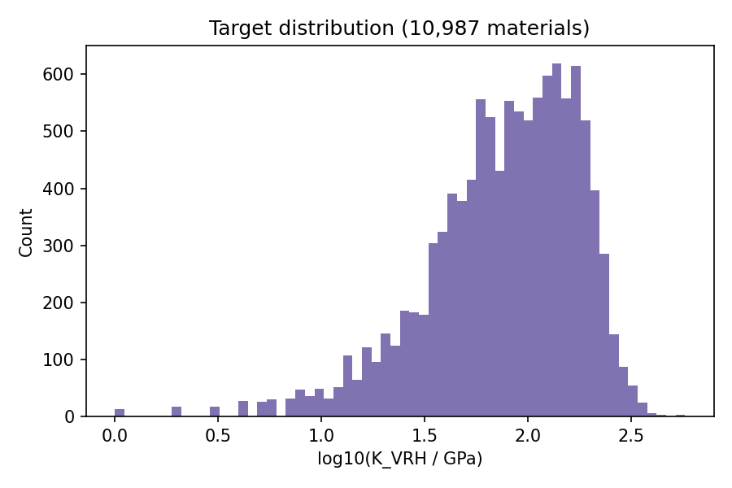

# 03 – Results

All numbers are on the **hold-out test set of 2,198 materials** that were never used for training (80/20 split, seed 42). CV = 5-fold cross-validation on the training set (mean ± std).

## 1. Model comparison

| Model | CV MAE (log10) | Test MAE (log10) | Test RMSE (log10) | Test R² | Test MAE (GPa) |
|---|---|---|---|---|---|
| Linear Regression | 0.1085 ± 0.0016 | 0.1090 | 0.1665 | 0.807 | 19.59 |
| Random Forest | 0.0713 ± 0.0015 | 0.0696 | 0.1220 | 0.896 | 11.89 |
| MLP | 0.0910 ± 0.0036 | 0.0991 | 0.1493 | 0.845 | 18.33 |
| **Gradient Boosting** | **0.0674 ± 0.0010** | **0.0668** | **0.1162** | **0.906** | **11.21** |

**How to read the MAE:** an MAE of 0.067 in log10 units means predictions are typically off by a factor of 10^0.067 ≈ 1.17, i.e. **about 17 %**. In absolute terms the average error is about 11 GPa, on a target with a median of 86 GPa.

**Observations**
- **Gradient Boosting performs best** on every metric, with Random Forest a close second.
- **Tree ensembles beat linear and neural models.** Linear Regression cannot capture the non-linear link between descriptors and stiffness. The MLP does better than linear but needs more data or tuning to match the tree models on about 9k tabular samples.
- **Results are stable.** CV MAE and test MAE agree closely and the CV standard deviations are small, so the models are not overfitting a lucky split.

## 2. Parity plots

Points close to the dashed diagonal are accurate predictions. Gradient Boosting and Random Forest form the tightest band around the diagonal.

## 3. Which descriptors matter?

Top 5 (Random Forest impurity importance):

| Rank | Descriptor | Importance | Physical interpretation |
|---|---|---|---|
| 1 | `volume_per_atom` | 0.266 | Atoms packed more tightly resist compression more |
| 2 | `melting_point_mean` | 0.122 | High-melting elements form strong bonds, giving stiffer materials |
| 3 | `molar_volume_mean` | 0.074 | Larger atoms tend to give softer lattices |
| 4 | `density` | 0.064 | Denser materials are generally stiffer |
| 5 | `melting_point_max` | 0.043 | The presence of one strongly bonding element raises stiffness |

These match known physics: bulk modulus is closely tied to **atomic volume** and **bond strength**. The model is learning physically meaningful relationships, not arbitrary correlations.

## 4. Where does the model struggle?

- **Very soft materials** (`log10 K < 1`, K < 10 GPa) show the largest errors. They are rare in the dataset, so the model sees few examples.
- **Formula-only predictions** (in the app) are less accurate (R² ≈ 0.85, MAE ≈ 0.085) because different polymorphs of the same formula can have very different stiffness. Uploading the full structure as a CIF uses the more accurate model.

## 5. Example predictions (from the app)

| Material | Predicted (GPa) | DFT value(s) (GPa) | Model |
|---|---|---|---|
| Fe2O3 | 178 | 163 – 192 (5 polymorphs) | Formula-only |
| WC | 341 | 385 | Formula-only |
| NaLiS (test set) | 33.4 | 30.0 | Structure-aware |

## 6. Limitations and future work

- Hyperparameters were set by hand, not tuned systematically. Grid or Bayesian search could improve results further.
- The descriptors are handcrafted. Graph neural networks (e.g. CGCNN, MEGNet) learn directly from the atomic graph and are the current state of the art on this benchmark.
- The evaluation uses one 80/20 split plus CV. The official Matbench protocol uses its own 5-fold splits, so the numbers are close to, but not exactly comparable with, the Matbench leaderboard.
- Predictions are only as reliable as the DFT training data and are less trustworthy for chemistries unlike anything in the dataset.
